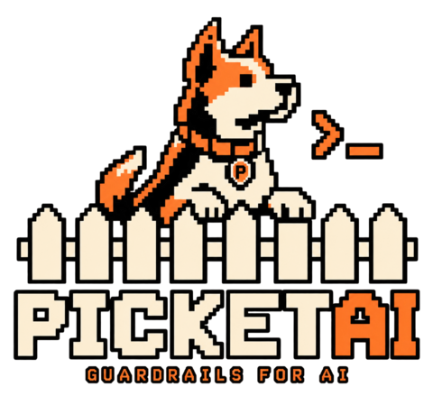

<p align="center">
  
</p>

<p align="center">
  <strong>A software-development workflow for Claude Code: four lanes, five agents, one kernel.</strong>
</p>

<p align="center">
  <a href="https://www.npmjs.com/package/@picketai/picket"></a>
  <a href="https://github.com/picketai/picket/actions/workflows/docs.yml"></a>
</p>

<p align="center">
  <a href="https://picketai.github.io/picket/"><strong>Get started</strong></a>
  ·
  <a href="https://picketai.github.io/picket/how-it-works/"><strong>How Picket works</strong></a>
  ·
  <a href="https://picketai.github.io/picket/how-to/"><strong>The daily loop</strong></a>
  ·
  <a href="https://picketai.github.io/picket/lanes/"><strong>In depth</strong></a>
  ·
  <a href="https://github.com/picketai/picket/blob/trunk/CHANGELOG.md"><strong>Changelog</strong></a>
</p>

You describe a change in plain words. Picket picks how much process it needs, writes a plan when one is worth having, implements it phase by phase, verifies each phase by running it, and stops for your approval before anything lands in git history.

Picket is an alpha, published on npm under the `alpha` dist-tag. Set up a project from its root; nothing is installed globally:

```sh
npx @picketai/picket@alpha init
```

## Documentation

The documentation is at **[picketai.github.io/picket](https://picketai.github.io/picket/)**.

- [Get started](https://picketai.github.io/picket/): install Picket, configure your project, set up testing, upgrade and uninstall.
- [How Picket works](https://picketai.github.io/picket/how-it-works/): the parts, and a change from your request to the commit.
- [The daily loop](https://picketai.github.io/picket/how-to/): a change in seven short steps.
- [The four lanes](https://picketai.github.io/picket/lanes/): fast, order, design and research, and how Picket picks one.
- [Troubleshooting](https://picketai.github.io/picket/troubleshooting/): what to do when something stops you.
- Reference: [agents](https://picketai.github.io/picket/reference/agents/), [skills](https://picketai.github.io/picket/reference/skills/), [commands](https://picketai.github.io/picket/reference/cli/), [hooks](https://picketai.github.io/picket/reference/hooks/) and [mods](https://picketai.github.io/picket/reference/mods/).

## The idea

Code decides what code can decide. Lane admission, the next action, phase verification, verdict routing and cost all come from `picket <verb>`; the model fills in what remains. State is the filesystem: one directory per work item under `work/<id>/`, read fresh on every call, never remembered.

## Compared with agent-skills and pstack

Two research reports compare Picket with two other collections of agent instructions for Claude Code: `work/20261017-compare-agent-skills-with-picket-skills/research.md` (agent-skills) and `work/20261017-compare-cursor-pstack-with-picket-skills/research.md` (pstack). The short version: agent-skills and pstack teach the model with prose and checklists it chooses to follow, while Picket enforces the same kind of rule in code where code can decide it.

| | agent-skills | pstack | Picket |
|---|---|---|---|
| Guards on the agent's own tool calls | three optional bash hooks | none | hooks that deny or bounce: destructive commands, kernel-owned files, new comments, silenced checks, malformed blocks |
| How much process a request gets | the model picks a skill | a router skill picks a playbook | `picket admit` picks the lane in code, from the text and the files touched |
| Stops for a human | by convention | by convention | one gate per phase, rendered by code; nothing lands in git without your approval |
| Proof a change works | checklists and an eval of the skills | red-first commit order, verification skills | a drive of the real entry point logged by a hook, and a red or pinning test named on the block |
| Measurement | a trigger and routing check of its skills | none reported | a cost and determinism bench with a regression check, plus labelled lane and skill-routing tests in `npm test` |

Both reports also name what the others do better, and several of those ideas are now in Picket: the untrusted-content rule, the guard against silenced checks, prove before change, the measured lane and routing checks, the design red flags and the repeated-mistake loop. Others are not, for example pstack's parallel design and review and agent-skills' wider domain guides; the reports list them.

Every Picket number in this README comes from a tracked file under `bench/results/`, here `bench/results/comparison-clean.md`: pass@1 of 100% against the previous harness's 93%, the intended lane on 100% of tasks against 57%, and 0.4 permission prompts per task against 3.1. No head-to-head bench run of agent-skills or pstack exists, so there are no numbers for them; the comparison above is from reading their sources.

## Working on Picket itself

Picket's source is `src/`, and `npm run build` writes the Claude Code plugin it ships to `dist/`. In this repository, start every session with `npm run claude`: it builds, then runs `claude --plugin-dir dist` with this checkout's `dist/bin` first on `PATH`, so `picket` is the checkout's kernel, not the plugin's.

The layout of the repository, the tests, the conventions and the release steps are in `CONTRIBUTING.md`. The benchmark that measures Picket itself, with its 18 golden tasks, is described in `bench/README.md`; every run spends real API budget, so dry-run first.

## A note from the maintainer

I did not set out to build Picket. It grew out of my own day-to-day work as I started using cloud platforms and AI agents in my professional life. It was not built for any particular company; it is simply the tool I use myself.

I built it to give myself confidence in the work I do. LLMs are a great addition to a developer's toolbox, but they are not a silver bullet for engineering. Picket will keep changing as I learn more about LLMs and as the models themselves evolve.

Picket won't write your specs for you, and it won't turn a spec into finished work on its own. It helps you implement your specs. It keeps your work sane and structured, so you don't have to worry at every step that the agent will go rogue on you.

If you find Picket helpful, feel free to use it. I'm always glad to hear feedback and suggestions for improvement.

Good luck engineering.
